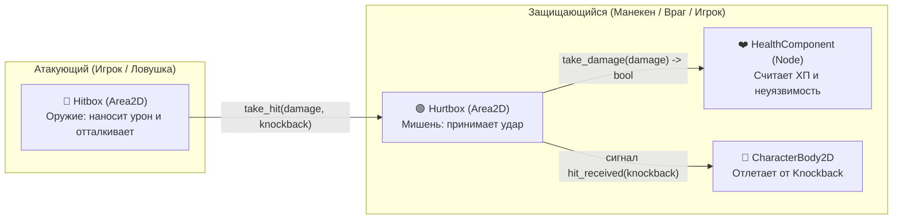
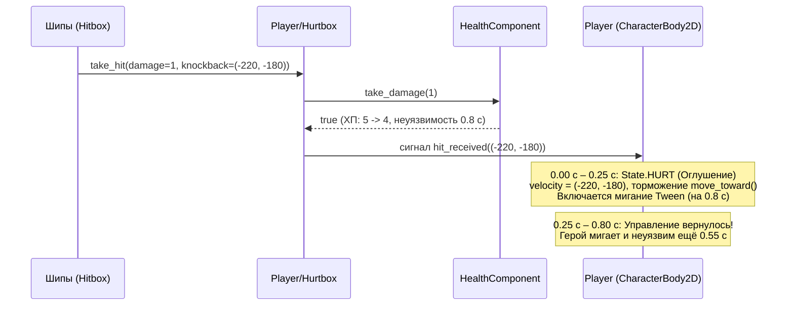

# ⚔️ Методический план занятия №7: «Боевая система: атака ближнего боя, Хитбоксы и Хёртбоксы (Hitbox / Hurtbox), получение урона и отталкивание (Knockback)»

**Формат:** Пошаговый LiveCode-практикум для детей (10–15 лет)  
**Продолжительность:** 90 минут (1.5 часа)  
**Движок:** Godot 4.3+ (2D Platformer)  
**Ветка проекта:** `feature/add-base-battle-system`  
**Главные принципы кода на занятии:** `1. Не хардкодить!` · `2. Никаких магических цифр!` · `3. YAGNI!` · `4. Разделяй ответственность (Компоненты)!`

---

## 🧭 Как преподавателю вести занятие по шагам (Git-ветки и подготовка)

Рекомендуемая разбивка занятия на контрольные этапы (если ученик отстал или нужно быстро показать готовый шаг):

```bash
git checkout step-1-layers-and-input   # Шаг 1: Слои физики (Player / Enemies) и кнопка атаки (Input Map)
git checkout step-2-hitbox-hurtbox     # Шаг 2: Компоненты Hurtbox и Hitbox + перевод шипов DamageZone на Hitbox
git checkout step-3-player-knockback   # Шаг 3: Хёртбокс игрока, отталкивание (Knockback), торможение и мигание
git checkout step-4-melee-attack       # Шаг 4: Атака ближнего боя (AttackHitbox, SlashSprite, таймеры и поворот)
git checkout step-5-training-dummy     # Шаг 5: Боевой манекен (TrainingDummy) со шкалой ХП и тест толкания на шипы
```

*Вернуться к полной итоговой ветке занятия:* `git checkout feature/add-base-battle-system`

### Чеклист преподавателя перед стартом урока:
1. **Быстрая отладка без ожидания катсцены:** в сцене `scenes/world.tscn` у узла `IntroPath` проверьте галочку **`Skip Intro = true`**.
2. **Включите отображение коллайдеров для наглядности:** в верхнем меню редактора выберите **Отладка (Debug) ➔ Отображать формы столкновений (Visible Collision Shapes)**. На этом занятии это наш главный рентген-прибор: дети своими глазами увидят зелёные зоны `Hurtbox` и вспыхивающие красные зоны `Hitbox` при взмахе мечом!
3. **Новые спрайты занятия (размер `32×32` px — 1 кадр, подключаются в 1 клик без нарезки `AtlasTexture`!):**
   - **Герой (`assets/animations/pink_man/`):**
     - `hit.png` — поза получения урона (зажмуренные глаза `><`).
     - `attack.png` — боевой выпад вперёд с клинком.
     - `slash.png` — голубая серповидная волна удара для узла `SlashSprite`.
   - **Тренировочный манекен (`assets/animations/training_dummy/`):**
     - `idle.png` (`32×32` px) — манекен-мишень в шлеме и с шипастыми плечами.
     - `hit.png` (`32×32` px) — манекен качается от удара, летят соломинки.
     - `destroy.png` (`160×32` px, 5 кадров по `32×32` px) — анимация разрушения манекена на обломки и облачка пыли (`loop = false`).

---

## ⏱️ Тайминг занятия (90 минут)

- **00:00 – 00:15 (15 мин)** — **Блок 1.** Теория на пальцах и в играх: три коробки персонажа (`Collision`, `Hurtbox`, `Hitbox`), матрица слоёв «Свой-Чужой» и настройка `Input Map`.
- **00:15 – 00:30 (15 мин)** — **Блок 2.** Прокачка `HealthComponent` и создание универсальной пары `Hurtbox` + `Hitbox`. Переводим шипы `DamageZone` на новый `Hitbox`.
- **00:30 – 00:50 (20 мин)** — **Блок 3.** Получение урона и физика отталкивания (`Knockback`): почему `velocity.x = direction * SPEED` «съедает» отскок, алгоритм торможения `move_toward`, состояние `HURT` и мигание через `Tween`.
- **00:50 – 01:10 (20 мин)** — **Блок 4.** Атака ближнего боя: собираем `AttackHitbox` со `SlashSprite`, пишем таймеры активного окна и перезарядки (`cooldown`), зеркалим меч при развороте героя.
- **01:10 – 01:25 (15 мин)** — **Блок 5.** Боевой партнёр без ИИ (`TrainingDummy`): собираем физический манекен с полоской `HealthBar` над головой и сталкиваем его ударами меча прямо на шипы!
- **01:25 – 01:30 (5 мин)** — **Блок 6.** Итоги, шпаргалка типичных ошибок, домашний челлендж и тизер Занятия 8 (Враги и ИИ на лучах `RayCast2D`).

---

## 🤺 Блок 1 (00:00 – 00:15). Зачем играм нужны Hitbox и Hurtbox? (Теория + Настройка)

### 1.1. Живое объяснение для детей: «Три невидимые коробки»

> **Слова преподавателя:**  
> *«Ребята, вспомните прошлое занятие: когда мы делали шипы `DamageZone`, они просто проверяли касание с физическим телом игрока (`CharacterBody2D`) и в цикле искали у него `HealthComponent`.  
> А теперь представьте, что мы дали нашему герою меч! Если всё тело героя — это одна общая коробка, как игра поймёт разницу между двумя ситуациями:  
> 1) Герой ударил монстра **своим мечом** (плохо монстру!).  
> 2) Монстр укусил героя **за ногу** (плохо герою!).  
> Если у обоих только по одной физической коробке — они просто столкнутся лбами, и непонятно, кто кого ударил!»*

#### 🤺 Пример из реальной жизни: спортивное фехтование
Представьте двух спортсменов-фехтовальщиков на Олимпиаде:
1. **Кроссовки и ноги (`CharacterBody2D` / `CollisionShape2D`)** — нужны только для того, чтобы стоять на полу дорожки и не проваливаться сквозь землю. Очки за касание кроссовок не дают!
2. **Электронный жилет на груди (`Hurtbox` — от англ. *Hurt* = «больно»)** — это **болевая зона (мишень)**. На жилете стоят датчики: если в него попадёт укол, спортсмен теряет очко здоровья.
3. **Наконечник шпаги или рапиры (`Hitbox` — от англ. *Hit* = «бить»)** — это **зона удара (оружие)**. Шпага сама урон не получает — она ищет только чужой жилет (`Hurtbox`)!

#### 🎮 Примеры из любимых игр:
- **Hollow Knight и Celeste (Секрет «честного» геймдизайна):**  
  В *Hollow Knight* зелёный `Hurtbox` рыцаря специально сделан на пару пикселей **у́же**, чем его плащ и физический коллайдер ног! Почему? Если шип лишь слегка задел край развевающегося плаща, игра прощает игрока и не отнимает маску здоровья. Игрок думает: *«Фух, еле увернулся, какой я ловкий!»*. А вот красный `Hitbox` взмаха гвоздя, наоборот, делают чуть шире нарисованной дуги, чтобы попадать по врагам было приятно и сочно!
- **Street Fighter, Super Smash Bros и Brawl Stars:**  
  Когда боец просто стоит или бежит, его кулак или меч безопасен (`Hitbox` **выключен**). Когда игрок нажимает кнопку атаки, `Hitbox` вспыхивает перед персонажем всего на **0.2 секунды** (это называется *Active Frames* — активные кадры удара) и тут же гаснет!



---

### 1.2. Защита от «Дружественного огня» (Матрица слоёв физики)

> **Вопрос классу:**  
> *«Мы повесим `Hurtbox` на нашего героя, и рядом на него же повесим `AttackHitbox` меча. Что случится в первую же секунду удара, если меч ищет любые `Hurtbox` подряд?»*  
> **Ответ детей:** *«Герой разрубит сам себя своим же мечом!»*

Чтобы меч героя никогда не бил самого героя, а два врага не кусали друг друга, в профессиональных играх на Godot используют **Слои и Маски столкновений (`Collision Layer` / `Collision Mask`)**:
- **`Layer` (Слой)** — это ответ на вопрос: **«КТО Я?»** (на какой полке я лежу).
- **`Mask` (Маска)** — это ответ на вопрос: **«КОГО Я ИЩУ?»** (на какие полки я смотрю).

#### Настраиваем слои физики в `Project Settings` (LiveCode):
1. Открываем **Проект (Project) ➔ Настройки проекта (Project Settings) ➔ Имена слоёв (Layer Names) ➔ 2D Физика (2D Physics)**.
2. К уже знакомым слоям 1–3 добавляем всего один новый слой — **Слой 4 (`Enemies`)**:
   - **Слой 1:** `Environment` *(Земля и стены)*
   - **Слой 2:** `Player` *(Игрок: и его физическое тело, и его `Hurtbox`)*
   - **Слой 3:** `Interactive Objects` *(Монетки и интерактивные предметы)*
   - **Слой 4:** **`Enemies`** *(Враги и манекены: и их физические тела, и их `Hurtbox`)*

> **Важный архитектурный вопрос (почему не нужны отдельные слои под `Hurtbox`?):**  
> В Godot `Area2D` строго разделяет проверку физических тел (`body_entered` / `get_overlapping_bodies()` — видит только `CharacterBody2D`, `StaticBody2D`) и других зон (`area_entered` / `get_overlapping_areas()` — видит только `Area2D`).  
> Поэтому:
> - Монетки и триггеры камер слушают `body_entered` на **Слое 2 (`Player`)** — они реагируют только на `CharacterBody2D` игрока и полностью игнорируют его `Hurtbox` (`Area2D`).
> - Оружие `Hitbox` проверяет `get_overlapping_areas()` и отбирает `if area is Hurtbox` — оно видит только `Hurtbox` на целевом слое и полностью игнорирует `CharacterBody2D`.
> - А на Занятии 8 лучи зрения врага (`RayCast2D`) смогут искать игрока на том же **Слое 2 (`Player`)** без раздувания таблицы слоёв!

Посмотрите, какая чистая таблица правил получается:

| Узел | `Collision Layer` («Кто я?») | `Collision Mask` («Кого я ищу?») | Как это работает в игре |
| :--- | :---: | :---: | :--- |
| **🔵 `Player` (`CharacterBody2D`)** | **Слой 2** (`Player`) | **Слой 1** (`Environment`) | Стоит на земле, подбирает монеты, активирует камеры. |
| **🟢 `Player/Hurtbox`** (`Area2D`) | **Слой 2** (`Player`) | *Пусто* (`0`) | Мишень игрока. Сама ни за кем не следит. |
| **🔵 `TrainingDummy` (`CharacterBody2D`)** | **Слой 4** (`Enemies`) | **Слой 1** (`Environment`) | Стоит на земле, не блокирует игрока как стена. |
| **🟢 `TrainingDummy/Hurtbox`** (`Area2D`) | **Слой 4** (`Enemies`) | *Пусто* (`0`) | Мишень врага/манекена. |
| **🔴 `Player/AttackHitbox`** (Меч) | *Пусто* (`0`) | **Слой 4** (`Enemies`) | Меч героя бьёт **только врагов** и не замечает самого героя! |
| **🔴 `TrainingDummy/Hitbox`** (Шипы манекена) | *Пусто* (`0`) | **Слой 2** (`Player`) | Враг бьёт **только игрока**, не задевая себя и других врагов. |
| **🔴 `DamageZone`** (Шипы на полу) | *Пусто* (`0`) | **Слой 2** (`Player`) *(или `2 + 4`)* | По умолчанию шипы бьют только игрока, а если включить в `Mask` ещё и Слой 4 (`Enemies`) — будут бить и столкнутых на них врагов! |

---

### 1.3. Добавляем действие `"attack"` в `Input Map`

1. В том же окне **Настройки проекта (Project Settings)** переключаемся на вкладку **Карта ввода (Input Map)**.
2. В поле **Добавить новое действие (Add New Action)** пишем **`attack`** и нажимаем **Добавить (Add)**.
3. Нажимаем **`+`** напротив `attack` и привязываем удобные кнопки:
   - **Кнопка мыши:** `Left Mouse Button` (ЛКМ — для тех, кто любит играть `A/D + Мышка`).
   - **Клавиша клавиатуры:** `J` (для тех, кто играет двумя руками на клавиатуре `A/D + Space + J`).
   - **Геймпад:** `Joypad Button 2` (кнопка `X` / `Square`).

---

## 🧩 Блок 2 (00:15 – 00:30). Прокачка `HealthComponent` и создание `Hurtbox` и `Hitbox` (LiveCode)

### 2.1. Апгрейд `scripts/health_component.gd`: возвращаем `bool` и сигнал `died`

> **Диалог с классом:**  
> *«На прошлом уроке метод `take_damage(amount)` ничего не возвращал (`-> void`). Но теперь, когда по персонажу прилетает удар с отталкиванием (`Knockback`), нам нужно знать: **а прошёл ли урон на самом деле?**  
> Ведь если герой сейчас находится в 0.8 секундах неуязвимости после прошлого ранения, он не должен снова подлетать в воздух от каждого касания!  
> Поэтому `take_damage()` теперь будет возвращать логический ответ `bool`:  
> - `true` — урон прошёл (нужно оттолкнуть персонажа и включить анимацию боли!);  
> - `false` — удар заблокирован неуязвимостью или персонаж уже повержен (ничего не делаем!).  
> А ещё добавим сигнал `signal died`, чтобы персонаж знал, когда его здоровье упало до нуля!»*

Обновляем **`res://scripts/health_component.gd`**:

```gdscript
class_name HealthComponent
extends Node

signal health_changed(current_health: int, max_health: int)
signal died

const MIN_HEALTH: int = 0

@export var max_health: int = 5
@export var invincibility_duration: float = 0.8

var _current_health: int = MIN_HEALTH
var _is_invincible: bool = false

var current_health: int:
	get:
		return _current_health

var is_invincible: bool:
	get:
		return _is_invincible

func _enter_tree() -> void:
	_set_health(max_health)

func take_damage(amount: int) -> bool:
	assert(amount > 0, "%s: урон должен быть больше 0 (передано: %d)!" % [name, amount])
	
	if _is_invincible or _current_health <= MIN_HEALTH:
		return false
	
	_set_health(_current_health - amount)
	if _current_health == MIN_HEALTH:
		died.emit()
	else:
		_start_invincibility()
	
	return true

func _set_health(value: int) -> void:
	_current_health = clampi(value, MIN_HEALTH, max_health)
	health_changed.emit(_current_health, max_health)

func _start_invincibility() -> void:
	if invincibility_duration <= 0.0:
		return
	
	_is_invincible = true
	await get_tree().create_timer(invincibility_duration).timeout
	_is_invincible = false
```

- *Обратите внимание:* мы убрали старый метод `get_from(node)` с циклом по дочерним узлам — он больше не нужен! Теперь `Hurtbox` хранит прямую `@export`-ссылку на свой `HealthComponent`.

---

### 2.2. Пишем компонент `scripts/hurtbox.gd` («Мишень»)

Создаём скрипт **`res://scripts/hurtbox.gd`**:

```gdscript
class_name Hurtbox
extends Area2D

signal hit_received(knockback: Vector2)

@export var health_component: HealthComponent
@export var receive_knockback: bool = true

func _ready() -> void:
	assert(health_component != null, "%s: 'health_component' обязателен для работы!" % name)

func take_hit(damage: int, knockback: Vector2) -> void:
	if not health_component.take_damage(damage):
		return
	
	var final_knockback: Vector2 = knockback if receive_knockback else Vector2.ZERO
	hit_received.emit(final_knockback)
```

**Разбор кода:**
- `Hurtbox` — идеальный пример **Принципа единой ответственности**: он не двигает персонажа, не крутит анимации и не считает таймеры.
- Когда в него прилетает вызов `take_hit(damage, knockback)` от любого `Hitbox`, он передаёт урон в `health_component.take_damage(damage)`.
- И **только если** `take_damage` вернул `true`, `Hurtbox` трубит сигнал `hit_received.emit(final_knockback)` своему владельцу (`Player` или `TrainingDummy`).
- **Гибкое управление отталкиванием (`@export var receive_knockback: bool = true`):** если в будущем мы сделаем тяжёлого босса, каменную турель или сундук, который должен получать урон, мигать, но **не отлетать** от ударов — достаточно снять галочку `Receive Knockback = false` в Инспекторе `Hurtbox` без единой правки кода!

---

### 2.3. Пишем компонент `scripts/hitbox.gd` («Оружие и Ловушка»)

#### 📐 Разбор алгоритма расчёта вектора отталкивания (`get_knockback_vector`)

> **Объяснение алгоритма на доске / экране:**  
> *«Как понять, в какую сторону оттолкнуть цель при ударе?  
> У нас есть координаты центра атакующего (`global_position.x`) и координаты цели (`target_position.x`).  
> - Если цель находится **правее** нас (`target_position.x >= global_position.x`) — толкаем её **вправо** (`RIGHT_DIRECTION = +1.0`).  
> - Если цель находится **левее** нас (`target_position.x < global_position.x`) — толкаем её **влево** (`LEFT_DIRECTION = -1.0`).  
>   
> **Хитрый вопрос классу:** Почему мы пишем `direction_x = LEFT_DIRECTION if target_position.x < global_position.x else RIGHT_DIRECTION`, а не стандартную функцию знака `sign(target_position.x - global_position.x)`?  
> **Ответ:** Если игрок упадёт сверху ровно в **центральный пиксель** шипа, разница `target_position.x - global_position.x` будет равна `0`! Функция `sign(0)` вернёт `0`, и героя подбросит строго вертикально вверх без смещения вбок — он приземлится обратно на тот же самый шип! А наше условие с `if / else` гарантирует, что направление по горизонтали всегда будет либо `-1.0`, либо `+1.0`!  
>   
> **И второй секрет платформеров:** почему мы возвращаем `Vector2(direction_x * knockback_force, -knockback_up_force)` с минусом по оси `Y`?  
> В Godot ось `Y` направлена вниз, значит `-knockback_up_force` слегка **подбрасывает цель вверх**! В *Hollow Knight*, *Mario* и *Minecraft* при ударе персонаж никогда не едет носом по полу — он отлетает по красивой дуге-параболе!»*

Создаём скрипт **`res://scripts/hitbox.gd`**:

```gdscript
class_name Hitbox
extends Area2D

const LEFT_DIRECTION: float = -1.0
const RIGHT_DIRECTION: float = 1.0

@export var damage: int = 1
@export var knockback_force: float = 220.0
@export var knockback_up_force: float = 180.0
@export var active_by_default: bool = true
@export var collision_shape: CollisionShape2D

func _ready() -> void:
	set_active(active_by_default)

func _physics_process(_delta: float) -> void:
	if not monitoring or not has_overlapping_areas():
		return
	
	for area: Area2D in get_overlapping_areas():
		if area is Hurtbox and (owner == null or area.owner != owner):
			var hurtbox: Hurtbox = area as Hurtbox
			var knockback: Vector2 = get_knockback_vector(hurtbox.global_position)
			hurtbox.take_hit(damage, knockback)

func set_active(active: bool) -> void:
	monitoring = active
	visible = active
	if collision_shape != null:
		collision_shape.set_deferred("disabled", not active)

func get_knockback_vector(target_position: Vector2) -> Vector2:
	var direction_x: float = LEFT_DIRECTION if target_position.x < global_position.x else RIGHT_DIRECTION
	return Vector2(direction_x * knockback_force, -knockback_up_force)
```

**Два важных защитных механизма в `Hitbox`:**
1. **Защита от самострела `(owner == null or area.owner != owner)`:** даже если у двух врагов включён урон друг по другу (Friendly Fire на Слое 4 `Enemies`), `Hitbox` никогда не ударит `Hurtbox`, принадлежащий тому же самому корневому узлу (`owner`)!
2. **Метод `set_active(active: bool)` и флаг `active_by_default`:**
   - У **шипов (`DamageZone`)** и **шипастых плеч манекена** галочка `Active By Default = true`: они опасны постоянно.
   - А у **меча игрока (`AttackHitbox`)** мы снимем галочку `Active By Default = false`: в начале игры меч спрятан (`visible = false`), не проверяет столкновения (`monitoring = false`), и его коллайдер отключён (`disabled = true`), пока игрок не нажмёт кнопку атаки!

---

### 2.4. Переводим шипы `scenes/damage_zone.tscn` на универсальный `Hitbox`

1. Открываем сцену **`res://scenes/damage_zone.tscn`**.
2. На корневой узел `DamageZone` (`Area2D`) вместо старого `damage_zone.gd` перетаскиваем наш новый скрипт **`res://scripts/hitbox.gd`** *(старый файл `scripts/damage_zone.gd` можно смело удалить из проекта!)*.
3. В Инспекторе у `DamageZone`:
   - В слот **`Collision Shape`** назначаем дочерний узел `CollisionShape2D`.
   - В разделе **Collision**:
     - `Layer` — пусто (`0`).
     - `Mask` — включаем **Слой 2 (`Player`)** (по умолчанию шипы ранят и отталкивают только игрока; а если на какой-то ловушке включить ещё и **Слой 4 (`Enemies`)**, то шипы будут бить и врагов!).

---

## 💥 Блок 3 (00:30 – 00:50). Получение урона и отталкивание (`Knockback`) у Игрока (LiveCode)

### 3.1. Добавляем `Hurtbox` и анимацию `"hit"` в `scenes/player.tscn`

1. Открываем **`res://scenes/player.tscn`** и выбираем `AnimatedSprite`:
   - В панели `SpriteFrames` создаём новую анимацию **`"hit"`** (`5 FPS`).
   - Нажимаем иконку папки 📁 (**Добавить кадр из файла / Add Frame from File**) и выбираем **`res://assets/animations/pink_man/hit.png`**.
2. Выбираем корневой узел `Player` и добавляем дочерний узел **`Area2D`**, называем его **`Hurtbox`**:
   - Прикрепляем к нему скрипт **`res://scripts/hurtbox.gd`**.
   - В Инспекторе у `Hurtbox` в поле **`Health Component`** назначаем узел `HealthComponent`.
   - В разделе **Monitoring** снимаем галочку **`Monitoring = false`** (мишень сама никого не ищет, экономим ресурсы процессора!).
   - В разделе **Collision**:
     - `Layer` = **Слой 2 (`Player`)**.
     - `Mask` = пусто (`0`).
3. Внутрь `Hurtbox` добавляем **`CollisionShape2D`**:
   - Создаём `New RectangleShape2D` размером **`12 × 20` px** и ставим `Position = Vector2(0, 4)`.
   - *Показываем детям:* физический коллайдер героя имеет размер `16 × 24`, а `Hurtbox` — `12 × 20` (на 2 пикселя меньше с каждого края — тот самый «прощающий» хёртбокс из *Hollow Knight*!).
   - В разделе **Debug Color** у `CollisionShape2D` ставим полупрозрачный **зелёный цвет**, чтобы на экране отладки всегда отличать зелёную мишень `Hurtbox` от красного оружия `Hitbox`!

---

### 3.2. Главная физическая ловушка: почему `velocity = knockback` не работает в лоб?

> **Живой эксперимент преподавателя:**  
> *«Ребята, казалось бы — что может быть проще отталкивания? Подпишемся на сигнал `hurtbox.hit_received` и напишем одну строчку: `velocity = knockback`!  
> Но посмотрите на наш метод `handle_movement(direction)` в `player.gd`:*  
> ```gdscript
> func handle_movement(direction: float) -> void:
>     velocity.x = direction * SPEED
> ```
> *Эта строчка выполняется **60 раз в секунду** в каждом физическом кадре!  
> Если шип толкнёт нас влево со скоростью `velocity.x = -220`, а мы в этот момент не жмём кнопки (`direction = 0`), то уже через **1/60 долю секунды** строчка `velocity.x = 0 * 300` обнулит горизонтальную скорость! В итоге герой просто подпрыгнет на месте, как на батуте, и упадёт обратно на шип!»*

#### 🧠 Алгоритм отталкивания с оглушением (*Hit Stun*) и трением (`move_toward`)

Как это решается в настоящих платформерах (*Hollow Knight*, *Dead Cells*, *Mega Man*)?
1. Когда герой получает удар, запускается короткий таймер оглушения **`_knockback_timer = knockback_duration`** (всего на **`0.25` секунды**).
2. Пока `_knockback_timer > 0.0` (метод `is_hurt()` возвращает `true`):
   - Игрок временно не может перебить скорость кнопками `A`/`D` или нажать атаку;
   - Вместо жёсткого `velocity.x = direction * SPEED` работает **плавное торможение от трения воздуха/земли**:
     ```gdscript
     velocity.x = move_toward(velocity.x, 0.0, knockback_friction * delta)
     ```
   - Машина состояний включает состояние **`State.HURT`** (проигрывается анимация `"hit"`).
3. Через **`0.25` секунды** управление полностью возвращается игроку, но неуязвимость (`0.8` с) и **мигание спрайта** продолжаются ещё `0.55` секунды, чтобы игрок спокойно выбежал из опасной зоны!



---

## ⚔️ Блок 4 (00:50 – 01:10). Атака ближнего боя (`AttackHitbox` и таймеры удара) (LiveCode)

### 4.1. Собираем оружие `AttackHitbox` в `scenes/player.tscn`

1. В `scenes/player.tscn` выбираем `AnimatedSprite` и добавляем анимацию **`"attack"`** (`5 FPS`) с кадром **`res://assets/animations/pink_man/attack.png`**.
2. Выбираем корневой узел `Player` и добавляем дочерний узел **`Area2D`** с именем **`AttackHitbox`**:
   - **Важное правило координат:** сам узел `AttackHitbox` оставляем строго в центре героя **`Position = Vector2(0, 0)`**!  
     *Зачем:*
     1. Когда мы будем поворачивать оружие влево/вправо через `attack_hitbox.scale.x = -1.0` или `1.0`, оно будет идеально зеркалиться относительно центра игрока!
     2. Так как `attack_hitbox.global_position` совпадает с центром игрока, формула отталкивания `target_position.x < global_position.x` всегда будет толкать врага **от игрока**, даже если враг подошёл вплотную!
   - Прикрепляем к `AttackHitbox` наш универсальный скрипт **`res://scripts/hitbox.gd`**.
   - В Инспекторе у `AttackHitbox`:
     - **`Knockback Force = 240.0`**, **`Knockback Up Force = 170.0`**.
     - Снимаем галочку **`Active By Default = false`** (меч включается только в момент удара!).
     - В разделе **Collision**: `Layer = 0` (пусто), **`Mask` = Слой 4 (`Enemies`)**.
3. Внутрь `AttackHitbox` добавляем два дочерних узла с одинаковым смещением **`Position = Vector2(18, 2)`** (прямо перед героем!):
   - **`SlashSprite` (`Sprite2D`)** — перетаскиваем текстуру **`res://assets/animations/pink_man/slash.png`**.
   - **`CollisionShape2D`** — создаём `New RectangleShape2D` размером **`20 × 22` px** (в `Debug Color` ставим полупрозрачный **красный цвет**).
4. Возвращаемся к узлу `AttackHitbox` и в слот **`Collision Shape`** назначаем его дочерний `CollisionShape2D`.

---

### 4.2. Два таймера боевой системы и приоритет состояний в `scripts/player.gd`

> **Вопрос классу:**  
> *«Почему для атаки нужны **два** разных таймера: `attack_duration = 0.2` (длительность взмаха) и `attack_cooldown = 0.35` (перезарядка удара)?»*  
> **Ответ:**  
> - **`attack_duration` (`0.2` с)** — сколько времени клинок виден на экране и наносит урон (*Active Frames*).  
> - **`attack_cooldown` (`0.35` с)** — минимальная пауза между двумя нажатиями кнопки удара (*Recovery*). Если бы перезарядка равнялась длительности удара (`0.2` с), то при быстрых кликах мыши волна меча просто висела бы перед героем вечно, как бензопила!

Обновляем **`res://scripts/player.gd`** (не забываем назначить `HealthComponent`, `Hurtbox` и `AttackHitbox` в слоты Инспектора у `Player` в `scenes/player.tscn`!):

```gdscript
class_name Player
extends CharacterBody2D

const FULL_ALPHA: float = 1.0
const HALF_INTERVAL_FACTOR: float = 0.5

static var instance: Player

@export var SPEED: float = 300.0
@export var JUMP_VELOCITY: float = -400.0
@export var attack_duration: float = 0.2
@export var attack_cooldown: float = 0.35
@export var knockback_duration: float = 0.25
@export var knockback_friction: float = 600.0
@export var hit_flash_interval: float = 0.12
@export_range(0.0, 1.0) var hit_flash_alpha: float = 0.35

@export var animated_sprite: AnimatedSprite2D
@export var coin_wallet: CoinWallet
@export var health_component: HealthComponent
@export var hurtbox: Hurtbox
@export var attack_hitbox: Hitbox

enum State {
	IDLE,
	RUN,
	JUMP,
	FALL,
	ATTACK,
	HURT
}

var current_state: State = State.IDLE

var gravity: float = ProjectSettings.get_setting("physics/2d/default_gravity")
var can_move: bool = true

var _attack_timer: float = 0.0
var _attack_cooldown_timer: float = 0.0
var _knockback_timer: float = 0.0
var _hit_tween: Tween

func _enter_tree() -> void:
	assert(instance == null, "На сцене может быть только один экземпляр Player!")
	instance = self

func _exit_tree() -> void:
	if instance == self:
		instance = null

func _ready() -> void:
	assert(animated_sprite != null, "%s: 'animated_sprite' обязателен для работы!" % name)
	assert(coin_wallet != null, "%s: 'coin_wallet' обязателен для работы!" % name)
	assert(health_component != null, "%s: 'health_component' обязателен для работы!" % name)
	assert(hurtbox != null, "%s: 'hurtbox' обязателен для работы!" % name)
	assert(attack_hitbox != null, "%s: 'attack_hitbox' обязателен для работы!" % name)
	
	hurtbox.hit_received.connect(_on_hurtbox_hit_received)
	health_component.died.connect(_on_died)

static func set_movement_enabled(enabled: bool) -> void:
	assert(instance != null, "Player: экземпляр игрока отсутствует на сцене!")
	instance.can_move = enabled

func _physics_process(delta: float) -> void:
	apply_gravity(delta)
	update_timers(delta)
	
	var direction: float = 0.0
	if can_move and not is_hurt():
		handle_jump()
		handle_attack()
		direction = Input.get_axis("move_left", "move_right")
	
	handle_movement(direction, delta)
	
	move_and_slide()
	
	handle_flip(direction)
	update_state(direction)
	play_animation()

func apply_gravity(delta: float) -> void:
	if not is_on_floor():
		velocity.y += gravity * delta

func update_timers(delta: float) -> void:
	if _attack_cooldown_timer > 0.0:
		_attack_cooldown_timer = maxf(0.0, _attack_cooldown_timer - delta)
	
	if _attack_timer > 0.0:
		_attack_timer = maxf(0.0, _attack_timer - delta)
		if _attack_timer == 0.0:
			stop_attack()
	
	if _knockback_timer > 0.0:
		_knockback_timer = maxf(0.0, _knockback_timer - delta)

func handle_jump() -> void:
	if Input.is_action_just_pressed("jump") and is_on_floor():
		velocity.y = JUMP_VELOCITY

func handle_attack() -> void:
	if Input.is_action_just_pressed("attack") and _attack_cooldown_timer <= 0.0 and not is_attacking():
		start_attack()

func start_attack() -> void:
	_attack_timer = attack_duration
	_attack_cooldown_timer = attack_cooldown
	attack_hitbox.set_active(true)

func stop_attack() -> void:
	_attack_timer = 0.0
	attack_hitbox.set_active(false)

func is_attacking() -> bool:
	return _attack_timer > 0.0

func is_hurt() -> bool:
	return _knockback_timer > 0.0

func handle_movement(direction: float, delta: float) -> void:
	if is_hurt():
		velocity.x = move_toward(velocity.x, 0.0, knockback_friction * delta)
	else:
		velocity.x = direction * SPEED

func handle_flip(direction: float) -> void:
	if is_attacking():
		return
	
	if direction > 0.0:
		animated_sprite.flip_h = false
		attack_hitbox.scale.x = absf(attack_hitbox.scale.x)
	elif direction < 0.0:
		animated_sprite.flip_h = true
		attack_hitbox.scale.x = -absf(attack_hitbox.scale.x)

func update_state(direction: float) -> void:
	if is_hurt():
		current_state = State.HURT
	elif is_attacking():
		current_state = State.ATTACK
	elif is_on_floor():
		if direction == 0.0:
			current_state = State.IDLE
		else:
			current_state = State.RUN
	else:
		if velocity.y < 0.0:
			current_state = State.JUMP
		else:
			current_state = State.FALL

func play_animation() -> void:
	match current_state:
		State.IDLE:
			animated_sprite.play("idle")
		State.RUN:
			animated_sprite.play("run")
		State.JUMP:
			animated_sprite.play("jump")
		State.FALL:
			animated_sprite.play("fall")
		State.ATTACK:
			animated_sprite.play("attack")
		State.HURT:
			animated_sprite.play("hit")

func _on_hurtbox_hit_received(knockback: Vector2) -> void:
	stop_attack()
	if knockback != Vector2.ZERO:
		velocity = knockback
	_knockback_timer = knockback_duration
	play_hit_flash()

func play_hit_flash() -> void:
	if _hit_tween and _hit_tween.is_running():
		_hit_tween.kill()
	
	animated_sprite.modulate.a = FULL_ALPHA
	if hit_flash_interval <= 0.0 or health_component.invincibility_duration <= 0.0:
		return
	
	var flash_count: int = maxi(1, int(health_component.invincibility_duration / hit_flash_interval))
	var half_step: float = hit_flash_interval * HALF_INTERVAL_FACTOR
	_hit_tween = create_tween().set_loops(flash_count)
	_hit_tween.tween_property(animated_sprite, "modulate:a", hit_flash_alpha, half_step)
	_hit_tween.tween_property(animated_sprite, "modulate:a", FULL_ALPHA, half_step)

func _on_died() -> void:
	get_tree().call_deferred("reload_current_scene")
```

**Разбор важных деталей `player.gd` со студентами:**
1. **Иерархия приоритетов в `update_state(direction)`:**
   - Почему `if is_hurt():` проверяется **первым**, `elif is_attacking():` — **вторым**, и только потом проверяется пол и прыжок?
   - Потому что получение урона (`HURT`) важнее всего (и даже прерывает начатый взмах через `stop_attack()`!), а взмах мечом (`ATTACK`) должен быть виден, даже если герой бьёт в прыжке или на бегу!
2. **Почему в `handle_flip(direction)` стоит `if is_attacking(): return`?**
   - В *Hollow Knight* и *Dead Cells*, если вы уже взмахнули мечом вправо, во время этих 0.2 секунд взмаха нельзя мгновенно перекинуть лезвие за спину, пока удар не завершится.
3. **Почему перезапуск сцены при гибели вызывается через `call_deferred("reload_current_scene")`?**
   - Сигнал `died` срабатывает прямо посреди просчёта физики (`_physics_process` внутри `Hitbox`). В Godot нельзя уничтожать всю сцену в тот самый момент, когда физический движок проверяет столкновения — `call_deferred` вежливо просит движок перезагрузить уровень сразу после завершения текущего физического кадра!

> **Промежуточный тест (`F5`):**  
> Запускаем игру! Нажимаем ЛКМ или `J` — перед героем на 0.2 секунды вспыхивает серповидная волна удара и красный прямоугольник `AttackHitbox`, а при повороте влево/вправо меч автоматически разворачивается в сторону взгляда! Наступаем на шипы — герой вскрикивает (`"hit"`), отлетает по параболе назад и мигает 0.8 секунды!

---

## 🎯 Блок 5 (01:10 – 01:25). Тренировочный манекен (`TrainingDummy`) — боевая мишень без ИИ (LiveCode)

> **Слова преподавателя:**  
> *«У нас есть меч, но кого им бить? На следующем, 8-м занятии мы научим врагов патрулировать платформы с помощью лазерных лучей `RayCast2D` и замечать игрока.  
> А сегодня, следуя правилу **YAGNI**, мы не пишем искусственный интеллект, но соберём полноценного физического партнёра для спарринга — **Тренировочный манекен (`TrainingDummy`)**!  
> Он стоит на земле под действием гравитации, умеет получать урон, отлетать от наших ударов, ранить игрока своими шипастыми плечами при столкновении вплотную и даже имеет собственную мини-полоску здоровья над головой!»*

### 5.1. Создаём скрипт `scripts/training_dummy.gd` с анимацией разрушения

Создаём **`res://scripts/training_dummy.gd`**:

```gdscript
class_name TrainingDummy
extends CharacterBody2D

const FULL_ALPHA: float = 1.0
const HALF_INTERVAL_FACTOR: float = 0.5

@export var knockback_duration: float = 0.25
@export var knockback_friction: float = 650.0
@export var hit_flash_interval: float = 0.1
@export_range(0.0, 1.0) var hit_flash_alpha: float = 0.4

@export var animated_sprite: AnimatedSprite2D
@export var health_component: HealthComponent
@export var hurtbox: Hurtbox
@export var hitbox: Hitbox

var gravity: float = ProjectSettings.get_setting("physics/2d/default_gravity")
var _knockback_timer: float = 0.0
var _is_destroyed: bool = false
var _hit_tween: Tween

func _ready() -> void:
	assert(animated_sprite != null, "%s: 'animated_sprite' обязателен для работы!" % name)
	assert(health_component != null, "%s: 'health_component' обязателен для работы!" % name)
	assert(hurtbox != null, "%s: 'hurtbox' обязателен для работы!" % name)
	assert(hitbox != null, "%s: 'hitbox' обязателен для работы!" % name)
	
	hurtbox.hit_received.connect(_on_hurtbox_hit_received)
	health_component.died.connect(_on_died)

func _physics_process(delta: float) -> void:
	if not is_on_floor():
		velocity.y += gravity * delta
	
	if _knockback_timer > 0.0:
		_knockback_timer = maxf(0.0, _knockback_timer - delta)
	
	velocity.x = move_toward(velocity.x, 0.0, knockback_friction * delta)
	move_and_slide()
	
	if not _is_destroyed:
		if _knockback_timer > 0.0:
			animated_sprite.play("hit")
		else:
			animated_sprite.play("idle")

func _on_hurtbox_hit_received(knockback: Vector2) -> void:
	if knockback != Vector2.ZERO:
		velocity = knockback
	if _is_destroyed:
		return
	
	_knockback_timer = knockback_duration
	play_hit_flash()

func play_hit_flash() -> void:
	if _hit_tween and _hit_tween.is_running():
		_hit_tween.kill()
	
	animated_sprite.modulate.a = FULL_ALPHA
	if hit_flash_interval <= 0.0 or health_component.invincibility_duration <= 0.0:
		return
	
	var flash_count: int = maxi(1, int(health_component.invincibility_duration / hit_flash_interval))
	var half_step: float = hit_flash_interval * HALF_INTERVAL_FACTOR
	_hit_tween = create_tween().set_loops(flash_count)
	_hit_tween.tween_property(animated_sprite, "modulate:a", hit_flash_alpha, half_step)
	_hit_tween.tween_property(animated_sprite, "modulate:a", FULL_ALPHA, half_step)

func _on_died() -> void:
	_is_destroyed = true
	if _hit_tween and _hit_tween.is_running():
		_hit_tween.kill()
	animated_sprite.modulate.a = FULL_ALPHA
	
	hitbox.set_active(false)
	hurtbox.set_deferred("monitorable", false)
	
	animated_sprite.play("destroy")
	await animated_sprite.animation_finished
	queue_free()
```

**Разбор алгоритма разрушения `_on_died()` (вспоминаем `coin.gd`!):**
1. **Зачем нужен флаг `_is_destroyed = true`?**  
   Пока проигрываются 5 кадров разлёта обломков (`"destroy"`), физика гравитации и отскока от финального удара (`velocity = knockback`) продолжает работать — манекен красиво разваливается прямо в полёте! Но флаг `if not _is_destroyed:` в `_physics_process` не даёт переключить анимацию обратно на `"hit"` или `"idle"`.
2. **Почему мы сразу выключаем `hitbox.set_active(false)` и `hurtbox.set_deferred("monitorable", false)`?**  
   Как только манекен сломался, его разлетающиеся щепки уже не должны ранить игрока при касании или принимать новые удары меча!
3. **Зачем у анимации `"destroy"` обязательно выключать зацикливание (`Loop = false`)?**  
   Как и у монетки в `coin.gd`, строчка `await animated_sprite.animation_finished` ждёт окончания анимации. Если оставить `Loop = true`, сигнал `animation_finished` никогда не сработает, и обломки будут взрываться бесконечно!

---

### 5.2. Собираем сцену `scenes/training_dummy.tscn` из готовых кубиков-компонентов!

Посмотрите, как окупается наша компонентная архитектура — мы собираем `TrainingDummy` как конструктор LEGO, используя **те же самые скрипты**, что и у игрока:

```text
TrainingDummy (CharacterBody2D)          [скрипт: training_dummy.gd] (Layer = 4 Enemies, Mask = 1 Environment)
├── AnimatedSprite (AnimatedSprite2D)    (анимации "idle", "hit" и 5-кадровая "destroy" [Loop = off, 11 FPS])
├── CollisionShape (CollisionShape2D)    (RectangleShape2D 14×28 px, Position = (0, 2))
├── HealthComponent (Node)               [скрипт: health_component.gd] (Max Health = 3, Invincibility = 0.25)
├── Hurtbox (Area2D)                     [скрипт: hurtbox.gd] (Layer = 4 Enemies, Mask = 0)
│   └── CollisionShape2D                 (RectangleShape2D 18×28 px, зелёный цвет)
├── Hitbox (Area2D)                      [скрипт: hitbox.gd] (Layer = 0, Mask = 2 Player)
│   └── CollisionShape2D                 (RectangleShape2D 16×22 px, красный цвет)
└── HealthBar (TextureProgressBar)       [скрипт: health_bar.gd с Занятия 6!] (Scale = (0.333, 0.333), над головой)
```

**Два супер-момента, которые нужно показать детям при сборке `training_dummy.tscn`:**
1. **Почему у `TrainingDummy` (`CharacterBody2D`) стоит `Collision Layer = 4` (`Enemies`), а `Collision Mask = 1` (`Environment`)?**  
   Манекен (и будущие враги на Занятии 8) находится на слое `Enemies`, но в маске его физического тела включён **только пол и стены (`Environment`)**. Если бы физическое тело врага сталкивалось с физическим телом игрока как бетонная стена, игрок мог бы запрыгнуть манекену на голову и стоять на нём как на табуретке! А так физические тела не блокируют друг друга, и любое боевое касание обрабатывается через `Hitbox` и `Hurtbox`!
2. **Переиспользование `health_bar.gd` с Занятия 6 без единой правки кода!**  
   Мы добавляем `TextureProgressBar` прямо над головой манекена (`Offset = (-16, -22)`, `Scale = (0.333, 0.333)`), вешаем на него `scripts/health_bar.gd` и указываем `HealthComponent` манекена. Полоска здоровья плавно работает над головой врага точно так же, как в экранном `HUD`!

---

### 5.3. Расставляем манекены в `scenes/world.tscn` и проводим боевое испытание!

1. Открываем **`res://scenes/world.tscn`**.
2. Добавляем узел `Node2D` с именем **`Dummies`** и размещаем внутри него экземпляры **`scenes/training_dummy.tscn`** (`Scale = Vector2(2, 2)`, под масштаб нашего героя):
   - **`TrainingDummy`** на `Position = Vector2(420, 250)` — слева от старта игрока (для дуэли на ровной площадке).
   - **`TrainingDummy2`** на `Position = Vector2(624, 250)` — справа от первых шипов (чтобы столкнуть его ударом меча прямо на колючки!).
   - **`TrainingDummy3`** на `Position = Vector2(1776, 250)` — между двумя рядами шипов в дальней части уровня.
   - *(Дополнительно: `scenes/training_dummy.tscn` также добавлен в `Scenes Collection` слоя `Objects`, так что манекены можно ставить и кистью по сетке!).*

> **Финальный тест занятия (`F5`) — Три эксперимента в прямом эфире:**  
> 1. **Проверка дистанции (*Spacing*):** Бежим на левый манекен без удара — шипастые плечи манекена (`Hitbox` манекена ➔ `Hurtbox` героя) ранят нас на 1 сердечко и отбрасывают назад!  
> 2. **Атака ближнего боя:** Подходим на дистанцию клинка и жмём `ЛКМ` / `J` — наш `AttackHitbox` достаёт до `Hurtbox` манекена раньше, чем мы коснёмся его плеч! Манекен качается (`"hit"`), мигает, отлетает по дуге назад, его полоска `HealthBar` плавно уменьшается на треть, а после 3-го удара манекен разлетается (`queue_free()`)!  
> 3. **Комбо с окружением:** Перепрыгиваем шипы справа от старта, разворачиваемся влево и бьём `TrainingDummy2` — манекен улетает от нашего `Knockback` прямо на шипы `DamageZone`, и шипы добивают его!

---

## 💡 Блок 6 (01:25 – 01:30). Шпаргалка типичных детских ошибок и Домашний челлендж

| Симптом проблемы | В чём реальная причина | Как исправить |
| :--- | :--- | :--- |
| **Герой при взмахе мечом ранит и отталкивает сам себя** | У `AttackHitbox` в `Mask` случайно включили Слой 2 (`Player`). | У `Player/AttackHitbox` оставить в `Mask` **только Слой 4 (`Enemies`)**. |
| **При получении урона герой подпрыгивает вверх, но совсем не отлетает вбок** | `velocity.x = direction * SPEED` в каждом кадре перезаписывает скорость отскока. | В `handle_movement()` проверять `if is_hurt():` и тормозить через `move_toward(velocity.x, 0.0, knockback_friction * delta)`. |
| **Меч бьёт врага вплотную, но притягивает его к игроку вместо отталкивания** | Сам узел `AttackHitbox` сдвинули на `(18, 2)` вместо его дочерних узлов, и он оказался позади центра врага. | Держать `AttackHitbox` в центре игрока `(0, 0)`, а смещение `(18, 2)` задавать его детям (`SlashSprite` и `CollisionShape2D`). |
| **При повороте влево герой смотрит влево, но меч всё равно бьёт вправо** | В `handle_flip()` поворачивается только `animated_sprite.flip_h`, а `attack_hitbox.scale.x` не меняется. | Менять знак масштаба: `attack_hitbox.scale.x = -absf(attack_hitbox.scale.x)` при `direction < 0.0` и `absf(attack_hitbox.scale.x)` при `direction > 0.0`. |
| **Волна удара `SlashSprite` видна постоянно с самого старта игры** | У `AttackHitbox` забыли выключить `Active By Default`. | В Инспекторе `Player/AttackHitbox` снять галочку **`Active By Default = false`**. |
| **Манекен при гибели бесконечно проигрывает взрыв и не исчезает** | У анимации `"destroy"` в `SpriteFrames` осталась включённой петля `Loop`. | Выключить кнопку зацикливания **`Animation Looping` (`Loop = false`)** у анимации `"destroy"`, чтобы сработал `await animated_sprite.animation_finished`. |
| **Игра выдаёт ошибку при перезагрузке сцены в момент гибели** | `reload_current_scene()` вызвали напрямую во время физического шага `Area2D`. | Вызывать перезагрузку отложенно: `get_tree().call_deferred("reload_current_scene")`. |

---

## 🏆 Домашний челлендж для учеников

*(Соблюдаем все 4 правила: без хардкода, без магических цифр, YAGNI и разделение ответственности по компонентам!)*

1. **Отскок сверху при ударе в прыжке (*Pogo-jump* как в *Hollow Knight*):**  
   Если игрок бьёт мечом, находясь в воздухе (`not is_on_floor()`), и его `AttackHitbox` успешно попадает по врагу/манекену, слегка подбрасывать самого игрока вверх (`velocity.y = JUMP_VELOCITY * 0.6`). Для этого добавьте в `Hitbox` сигнал `signal hit_landed(hurtbox: Hurtbox)`!
2. **Разрушаемый деревянный ящик с монетками (`LootCrate`):**  
   Создать сцену ящика (`StaticBody2D` или `CharacterBody2D`) с `HealthComponent` (`max_health = 2`) и `Hurtbox` (Слой 4 `Enemies`), который при сигнале `died` спавнит на своём месте сцену `coin.tscn` и исчезает!
3. **Красная вспышка при ранении:**  
   В методе `play_hit_flash()` помимо прозрачности `modulate:a` кратковременно окрашивать спрайт в ярко-розовый/красный оттенок `Color(1.0, 0.4, 0.4)` на первом полушаге `Tween`, возвращая `Color.WHITE` на втором.

> **Анонс Занятия №8:**  
> *«Сегодня мы создали полноценный фундамент боевой системы: оружие, хитбоксы, хёртбоксы и физику отталкивания! А на следующем занятии мы вдохнём в наших противников жизнь и разум: научим врагов патрулировать платформы, проверять край пропасти и стены с помощью лазерных лучей `RayCast2D`, замечать игрока и проигрывать анимацию гибели!»*

